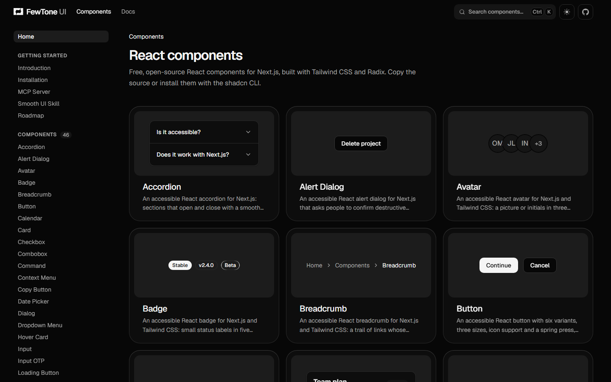

# FewTone UI

Accessible, customizable React components for Next.js and Tailwind CSS. Copy-paste source, installed with the shadcn CLI, by [FewTone](https://fewtone.com).

[](https://github.com/FewTone/ui/actions/workflows/ci.yml)
[](LICENSE)

**[Website](https://ui.fewtone.com)** · **[Components](https://ui.fewtone.com/components)** · **[Docs](https://ui.fewtone.com/docs)** · **[MCP server](https://ui.fewtone.com/docs/mcp)** · **[Smooth UI skill](https://ui.fewtone.com/docs/smooth-ui)**

[](https://ui.fewtone.com/components)

## Why FewTone UI

- **The code is yours.** Each component lands in your project as one readable file, like shadcn/ui. No package to update, nothing to work around.
- **Accessible by default.** Built on Radix, with full keyboard support, visible focus and screen-reader names. Every component is tested with axe.
- **Motion that explains.** Indicators that slide, panels that glide to their height, content that comes through a soft blur. Calm, never decorative, and it respects reduced motion.
- **Fits your theme.** Components use your project's shadcn colours and work in light and dark. They only add the few variables you don't already have.
- **Made for AI assistants too.** A free [MCP server](https://ui.fewtone.com/docs/mcp), [`llms.txt`](https://ui.fewtone.com/llms.txt), a Markdown version of every page, and a Copy prompt button on each component.

## Quick start

You need React 19, Tailwind CSS v4 and a project set up for shadcn. In a new Next.js app, run this once:

```bash
npx shadcn@latest init
```

Then add any component with the shadcn CLI:

```bash
npx shadcn@latest add https://ui.fewtone.com/r/button.json
```

The source is now in `components/ui/button.tsx`. Use it like your own:

```tsx
import { Button } from "@/components/ui/button"

export function Actions() {
  return <Button>Continue</Button>
}
```

Use pnpm, yarn or bun in place of npx (`pnpm dlx`, `yarn dlx`, `bunx --bun`). Manual steps, theming and troubleshooting are in the [installation guide](https://ui.fewtone.com/docs/installation).

## Components

<!-- components:start (written by `pnpm index` from packages/ui; don't edit by hand) -->
46 components, each with a live preview, examples and its API on [ui.fewtone.com](https://ui.fewtone.com/components).

| Category | Components |
| --- | --- |
| Buttons | [Button](https://ui.fewtone.com/components/button), [Copy Button](https://ui.fewtone.com/components/copy-button), [Loading Button](https://ui.fewtone.com/components/loading-button), [Switcher](https://ui.fewtone.com/components/switcher), [Theme Toggle](https://ui.fewtone.com/components/theme-toggle), [Toggle Group](https://ui.fewtone.com/components/toggle-group) |
| Display | [Avatar](https://ui.fewtone.com/components/avatar), [Card](https://ui.fewtone.com/components/card), [Scroll Area](https://ui.fewtone.com/components/scroll-area), [Table](https://ui.fewtone.com/components/table) |
| Effects | [Marquee](https://ui.fewtone.com/components/marquee), [Number Ticker](https://ui.fewtone.com/components/number-ticker), [Stepper](https://ui.fewtone.com/components/stepper), [Text Effects](https://ui.fewtone.com/components/text-effects) |
| Feedback | [Badge](https://ui.fewtone.com/components/badge), [Progress](https://ui.fewtone.com/components/progress), [Skeleton](https://ui.fewtone.com/components/skeleton), [Spinner](https://ui.fewtone.com/components/spinner), [Toast](https://ui.fewtone.com/components/toast) |
| Forms | [Calendar](https://ui.fewtone.com/components/calendar), [Checkbox](https://ui.fewtone.com/components/checkbox), [Combobox](https://ui.fewtone.com/components/combobox), [Date Picker](https://ui.fewtone.com/components/date-picker), [Input](https://ui.fewtone.com/components/input), [Input OTP](https://ui.fewtone.com/components/input-otp), [Number Input](https://ui.fewtone.com/components/number-input), [Radio Group](https://ui.fewtone.com/components/radio-group), [Select](https://ui.fewtone.com/components/select), [Slider](https://ui.fewtone.com/components/slider), [Switch](https://ui.fewtone.com/components/switch), [Textarea](https://ui.fewtone.com/components/textarea) |
| Navigation | [Accordion](https://ui.fewtone.com/components/accordion), [Breadcrumb](https://ui.fewtone.com/components/breadcrumb), [Command](https://ui.fewtone.com/components/command), [Navigation Menu](https://ui.fewtone.com/components/navigation-menu), [Pagination](https://ui.fewtone.com/components/pagination), [Sidebar](https://ui.fewtone.com/components/sidebar), [Tabs](https://ui.fewtone.com/components/tabs) |
| Overlays | [Alert Dialog](https://ui.fewtone.com/components/alert-dialog), [Context Menu](https://ui.fewtone.com/components/context-menu), [Dialog](https://ui.fewtone.com/components/dialog), [Dropdown Menu](https://ui.fewtone.com/components/dropdown-menu), [Hover Card](https://ui.fewtone.com/components/hover-card), [Popover](https://ui.fewtone.com/components/popover), [Sheet](https://ui.fewtone.com/components/sheet), [Tooltip](https://ui.fewtone.com/components/tooltip) |
<!-- components:end -->

## For AI assistants

- **MCP server:** connect Claude Code, Cursor, VS Code or Windsurf to `https://ui.fewtone.com/mcp` (free, no key). Your assistant can search the components, read their docs and examples, and install them. [Setup](https://ui.fewtone.com/docs/mcp).
- **llms.txt:** [`/llms.txt`](https://ui.fewtone.com/llms.txt) indexes the docs, and every page has a Markdown version at its address plus `.md`.
- **Copy prompt:** every component page has a button that copies a step-by-step brief for your assistant to add that component safely.

## Smooth UI skill

Not about FewTone UI: [Smooth UI](skills/smooth-ui) is a free Agent Skill holding everything learned building this library: motion rules, exact timings, which pattern fits which change, recipes for about 40 controls, working React code and the pitfalls. Add it to any project and your assistant builds smoother interfaces:

```bash
npx skills add FewTone/ui --skill smooth-ui
```

## Develop

This repo is a pnpm and Turborepo monorepo: the site is `apps/www` (Next.js) and the components are `packages/ui`, the source everything else is generated from.

```bash
pnpm install
pnpm dev     # http://localhost:3000
pnpm check   # lint, item index, types, design tokens and tests (CI runs it on every push)
```

- How the project works, for people and AI agents: [`AGENTS.md`](AGENTS.md)
- The design system: [`docs-internal/01-brand/design-system.md`](docs-internal/01-brand/design-system.md)

## Licence

[MIT](LICENSE) © FewTone.
